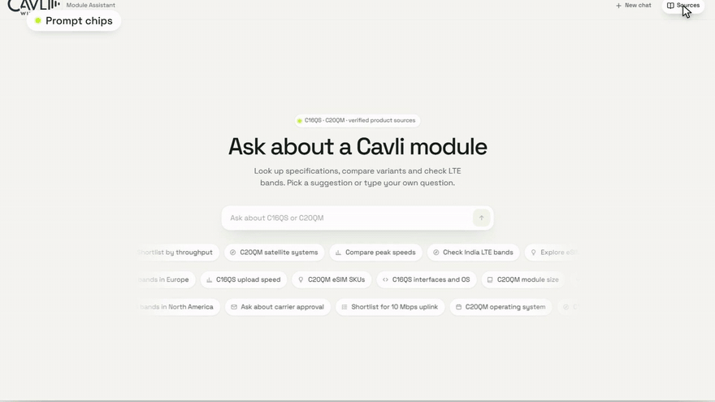

# Cavli Module Assistant

Assignment 1 browser prototype for two public Cavli cellular IoT modules. The app gives source-grounded answers, checks published throughput requirements, and records feedback for review.

*A 24-second excerpt from the demo film. The full film is in the submission folder.*

**Live demo:** [cavli-assignment-1.nishanameenk.workers.dev](https://cavli-assignment-1.nishanameenk.workers.dev). Sign in as `reviewer`; the password is in the submission PDF.

**Interface (redesigned 15 November 2026).** The home screen uses the vividsites Prompt Chips component: rows of suggested C16QS and C20QM questions drift past, stop on hover, and can be dragged. Clicking a chip flies it into the question bar and types the full question; you review it, then press Enter or Send. Follow-up questions use the same bar. The header shows the official Cavli Wireless logo, and the type is Space Grotesk, served from the site itself so the strict content security policy is unchanged. Reduced-motion settings hold the rows still, and the layout works at 375 px.

## Run it

1. Install Node.js 22 or later and run `npm install`.
2. Run `npm run preview`. From the ZIP you can also run `node scripts/preview.mjs` directly using the included prebuilt bundle. Open the URL printed by the terminal. Preview mode answers from the versioned catalog with no accounts and keeps feedback locally in `outputs/private/feedback/`.
3. For a connected preview, copy `.env.example` to `.dev.vars` and supply `SUPABASE_URL`, `CATALOG_TOKEN`, and `GEMINI_API_KEY` locally. Run `npm run dev` for the Workers runtime.
4. Run `npm run build` and then `npm run sample` to capture five real output records using the bundled Worker. Set `CAVLI_URL` for a hosted test or use `node --env-file-if-exists=.dev.vars scripts/sample.mjs` for in-process provider checks. Captured preview output reports its retrieval and generation mode per reply.

## Connect a new Supabase project

Apply the SQL files in `supabase/migrations` in filename order, then run `supabase/seed.sql`. Deploy `supabase/functions/cavli-catalog/index.ts` as `cavli-catalog` with gateway JWT verification disabled. The function verifies its own 64-hexadecimal-character bearer token and uses its built-in server credentials. The token table stores SHA-256 hashes only.

Create two random tokens locally, one short-lived seed token and one runtime token. In `cavli_runtime_keys` insert their SHA-256 hashes as `token_hash`, set `can_seed = true` only for the seed token, and set an expiry for the seed token. Send `{"action":"seed"}` with the seed bearer token to `/functions/v1/cavli-catalog` until the returned embedded count is zero. Remove the seed token hash after verifying the rows. Give the Worker the runtime token as `CATALOG_TOKEN`.

Example health check: `select count(*) from public.product_evidence where embedding is not null and extensions.vector_dims(embedding) = 384;` Expect 10 for this catalog. The CSV-free source catalog is `src/catalog.json`. Update its reviewed facts and regenerate the SQL seed together. For changed passages, set embeddings and model metadata to NULL and run the seed action again; rebuild the Worker to update its verified snapshot.

## Cloudflare deployment

Open the [verified hosted reviewer demo](https://cavli-assignment-1.nishanameenk.workers.dev). Sign in as `reviewer` with the password provided separately.

To redeploy the existing demo from an authenticated PowerShell session, run `npm run build` and then `& .\scripts\deploy-hosted.ps1` from the app directory. The script loads secrets from the local `.env`, deploys the Worker, and runs the hosted smoke checks. Keep `.env` outside the submission. For a different deployment, update the Worker configuration and smoke-test URL first.

For a repeatable browser check, provide Playwright and Chrome, build, then run `node scripts/browser-check.mjs`. It uses the bundled app and routes requests in-process so the test needs no listening port. `CAVLI_PLAYWRIGHT` optionally identifies a local Playwright package directory and `CAVLI_CHROME` a Chrome executable. To check the live site's interface, run `node --env-file=.env scripts/live-ui-check.mjs` with the same two variables. It reads the reviewer password from `.env`, never prints it, and writes `outputs/hosted-ui-check.json`.

## Review materials

- [Technical note and source inventory](TECHNICAL-NOTE.md)
- [Demo script](DEMO.md)
- [Five actual preview runs](outputs/sample-outputs.json)
- [Browser check](outputs/browser-check.json)
- [Live interface check](outputs/hosted-ui-check.json)
- [Hosted verification and timings](outputs/VERIFICATION.md)
